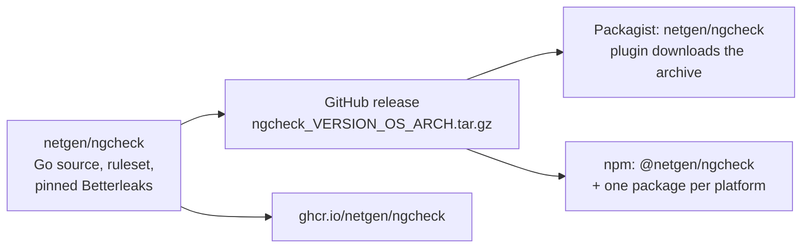

# ngcheck

Netgen project checks for git hooks and CI pipelines, usable in any stack (Symfony,
Node, anything with git).

`ngcheck secrets` blocks leaked secrets (passwords, API keys, tokens, private keys,
credentials in DSNs, committed `.env.local` files...) before they are committed and
in pull requests. It runs [Betterleaks](https://github.com/betterleaks/betterleaks)
with a ruleset for the stacks used at Netgen on top of the Betterleaks built-in rules.

```console
$ ngcheck secrets --staged
Scanning staged changes in /var/www/project

RULE             LOCATION
dsn-credentials  .env:4

ERROR: 1 potential secret(s) found.
```

## One repository, three distributions

Everything is built and published from this repository by the
[release workflow](.github/workflows/release.yml); there are no other repositories
to maintain.

| Used by | Package | Install |
|---|---|---|
| Symfony / PHP projects, CaptainHook | [`netgen/ngcheck`](https://packagist.org/packages/netgen/ngcheck) on Packagist | `composer require --dev netgen/ngcheck` |
| Node projects, Husky | [`@netgen/ngcheck`](https://www.npmjs.com/package/@netgen/ngcheck) on npm | `npm install --save-dev @netgen/ngcheck` |
| CI pipelines (GitHub, Bitbucket, GitLab) | `ghcr.io/netgen/ngcheck` Docker image | `image: ghcr.io/netgen/ngcheck:1` |

Each distribution ships the same two binaries: `ngcheck` (Go, this repository) and
the pinned Betterleaks release it runs. The ruleset is embedded in `ngcheck`.



## Documentation

- [Installation in projects](docs/installation.md): Composer + CaptainHook, npm + Husky,
  CI pipelines, adopting an existing project, configuration, troubleshooting.
- [Maintenance](docs/maintenance.md): one-time setup, releasing, updating Betterleaks
  and the ruleset, local development.

## Usage

```
ngcheck secrets [options] [path]

  --staged        scan the changes staged for commit (pre-commit hook)
  --since REF     scan the commits added after REF (REF..HEAD)
  --history       scan every commit of every branch
  --junit FILE    also write a JUnit XML report
  --json FILE     also write a JSON report
  --write-ignore  accept the current findings by adding them to .betterleaksignore
  --verbose       show finding fingerprints
```

Without a mode option, it scans the commits of the pull request in GitHub Actions,
Bitbucket Pipelines and GitLab CI pull request jobs, and the current content of all
tracked files everywhere else. Exit codes: `0` no secrets, `1` secrets found, `2` error.

## Development

Requires Go (see `go.mod`), git and a POSIX shell.

```sh
make test     # downloads the pinned Betterleaks into .cache/ and runs all tests
make lint
make build    # bin/ngcheck and bin/betterleaks for this machine
bin/ngcheck secrets --history
```

See [docs/maintenance.md](docs/maintenance.md) for the repository layout and release process.

## License

MIT. Betterleaks is MIT licensed as well, its license ships as `LICENSE.betterleaks`.
